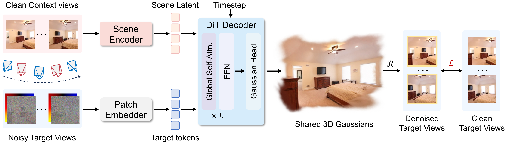

# PixGR: Pixel-Space Generative Decoding for Fast Feed-Forward 3D Reconstruction

  <strong>
    <a href="https://ranrhuang.github.io/">Ranran Huang</a>,
    <a href="https://bianwenjing.github.io/">Wenjing Bian</a>,
    <a href="https://github.com/Roldbach/">Weixun Luo</a>,
    <a href="https://yebulabula.github.io/">Ye Mao</a>, and
    <a href="https://www.imperial.ac.uk/people/k.mikolajczyk">Krystian Mikolajczyk</a>
  </strong>

  
  

Code will be coming soon. 🚧
